# Fixing the long tail: NYC street-maintenance requests


 
 [](reports/case_study_slides.pdf)

**A business-analysis and process-improvement case study on real public data: all 212,103 service
requests that New Yorkers sent to the Department of Transportation (DOT) through 311 in 2025.** It
finds where residents' waiting time builds up and why so much field effort ends with nothing to fix,
then redesigns the process and estimates the impact from the data.

> This is an **independent case study on public data**. It is not affiliated with, commissioned by or
> endorsed by NYC DOT, NYC 311 or the City of New York. Source and terms: [DATA.md](DATA.md).

| Read it as... | Link |
|---|---|
| 11-slide deck (PDF) | [`reports/case_study_slides.pdf`](reports/case_study_slides.pdf) |
| Every number used in the deck | [`reports/findings.json`](reports/findings.json), [`reports/tables/`](reports/tables) |
| The SQL | [`sql/`](sql) |
| Process maps (Mermaid) | [`process_maps/as_is.mmd`](process_maps/as_is.mmd), [`process_maps/to_be.mmd`](process_maps/to_be.mmd) |

## Contents
[Problem](#problem) · [Key findings](#key-findings) · [Recommendations and impact](#recommendations-and-impact) ·
[Approach](#approach) · [Process maps](#process-maps) · [How to run](#how-to-run) · [Validation](#validation-and-tests) ·
[Project layout](#project-layout) · [Limitations](#limitations)

## Problem
Residents report street conditions, broken street lights and signals, damaged sidewalks and missing
signs through 311, and DOT inspects and repairs them. In 2025 the median request closed in 1.9 days,
but 1 in 10 took 18 days or longer, and many inspections found nothing DOT could fix.

**Business questions**
1. Where does residents' waiting time accumulate, and what drives it?
2. How much inspection effort goes to requests DOT cannot or need not fix (*failure demand*)?
3. Which process changes would reduce waiting and wasted visits, and by how much?

## Key findings

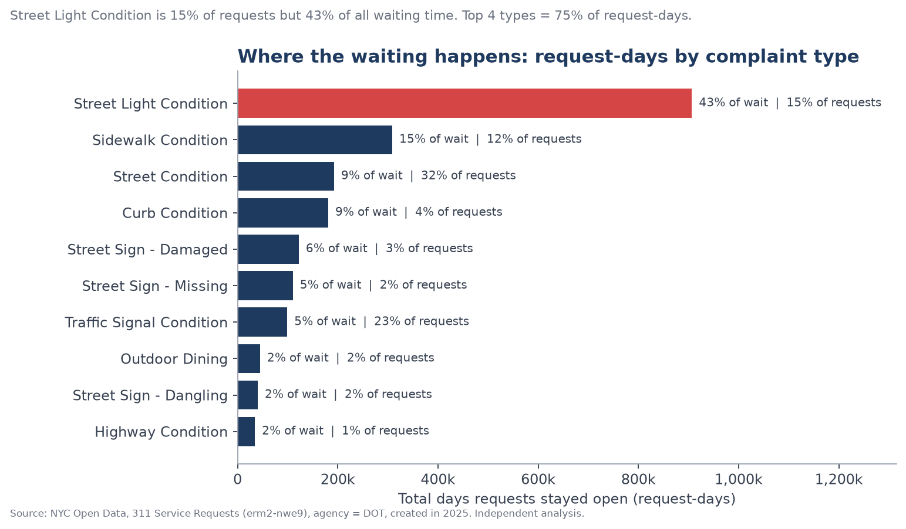

1. **Street lights are the waiting-time problem.** Street Light Condition is 15% of requests but
   43% of all waiting time (request-days). The top 4 complaint types hold 75% of request-days. Potholes
   are a success story: 71% repaired, median 0.9 days.
2. **A long tail, not a slow median.** For *Street Light Out*, the 15% of outages open more than 30 days hold
   75% of street-light waiting. Manhattan has the fastest median (4 days) but the longest tail
   (p90 90 days, against 29 days in Staten Island).
3. **39% of Street Condition requests are failure demand**: 27,506 of 70,330 ended as no defect
   found, wrong agency, duplicate or insufficient information. Cave-ins (58% referred elsewhere) and
   defective hardware (38%) mostly belong to DEP, which receives 88% of these referrals. 71% of
   "Blocked - Construction" reports find no defect.
4. **Outcomes are invisible for 46% of requests.** All street-light and traffic-signal closures say
   "see DOT website", so first-time-fix cannot be measured from open data. Also, 5,047 requests
   from 2025 were still open at the snapshot (median age about 450 days).

| Long tail | Failure demand |
|---|---|
| 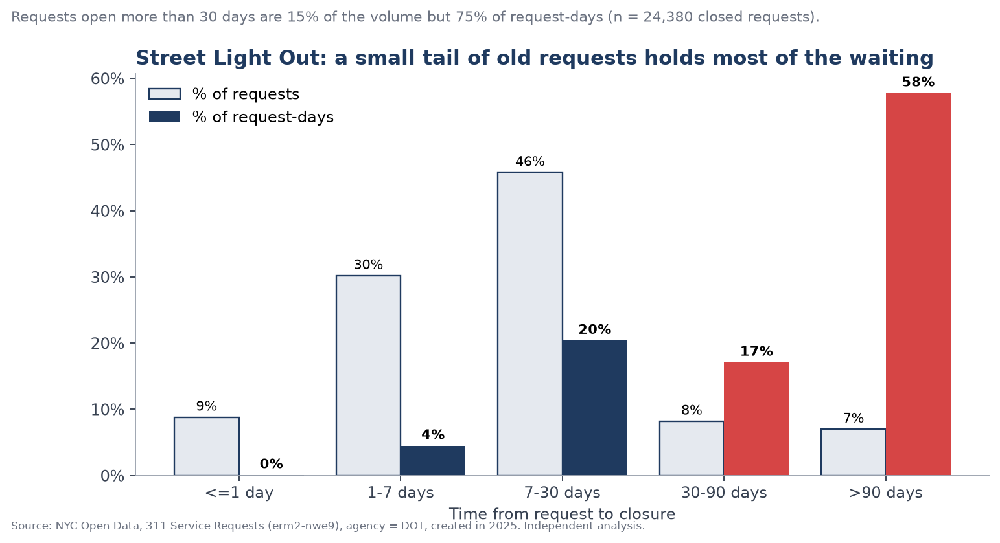 | 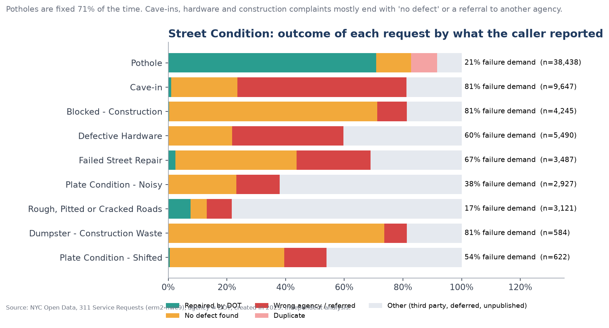 |

**Root causes (Ishikawa).** Each cause is backed by a number from the data:

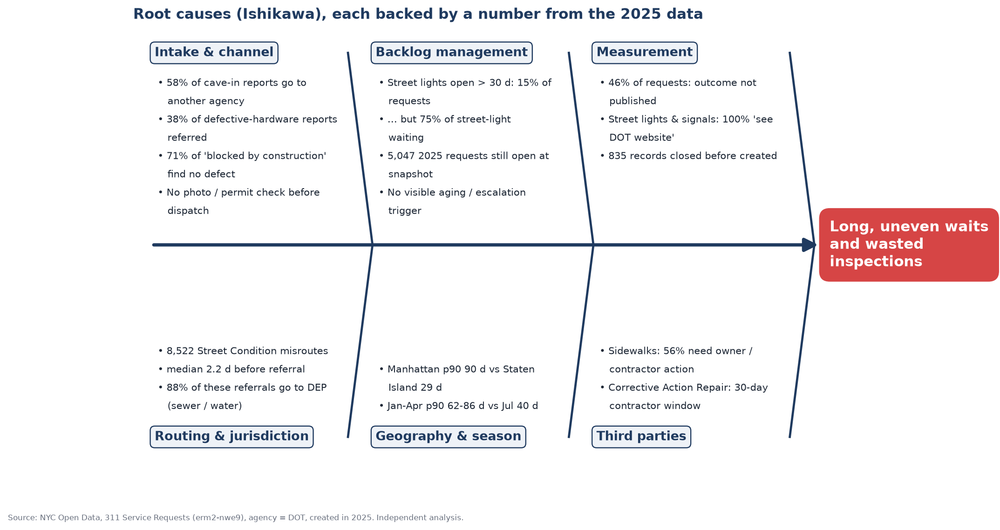

## Recommendations and impact

| # | Change | Addressable in 2025 | Base-case impact per year (low to high) |
|---|---|---|---|
| R1 | Guided intake routes sewer, manhole and utility cues straight to DEP or the utility | 8,522 misrouted requests | 4,261 DOT handlings and 14,893 citizen-days avoided (2,130–6,392 handlings) |
| R2 | Photo + map pin, duplicate check and active-permit check before an inspector is sent | 5,131 no-defect visits | 2,052 visits avoided (1,026–3,079), about 3,079 inspector-hours at an illustrative 1.5 h per visit |
| R3 | Escalate any street-light outage still open on day 30, plus a weekly aging report | 3,717 outages > 30 days | 184,802 citizen-days saved (92,401–277,203). Street Light Out p90 drops from 61 to 45 days |
| R4 | Publish a standard outcome code on every closure | 97,937 requests without a published outcome | First-time-fix becomes measurable for 100% of requests (no time saving claimed) |

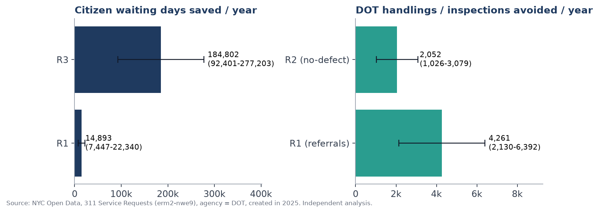

All assumptions (adoption rates, thresholds, hours per visit) are in [`assumptions.toml`](assumptions.toml).
The baselines come from the data, and changing an assumption and re-running updates every chart, the
deck and `findings.json`. R1 and R2 cover different requests (wrong agency vs no defect), so their
effects do not double-count.

## Approach

| Step | What | Tools |
|---|---|---|
| 1. Acquire | Download a dated snapshot through the public API and record row count, SHA-256 and the query | Python (stdlib), `scripts/download_data.py` |
| 2. Model | Staging → request facts → outcome classification (9 classes from DOT's free text) | **DuckDB SQL** (`sql/01_*.sql`, `02_*.sql`) |
| 3. Analyse | 10 named queries, each exported to CSV (Pareto, tail, borough, month, backlog, failure demand) | DuckDB SQL (`sql/03_analysis.sql`) |
| 4. Root cause | Pareto of request-days, tail analysis, segment cuts, failure-demand rates, Ishikawa | pandas, matplotlib |
| 5. Redesign | As-is and to-be process maps written in Mermaid with numbers filled in from the data | Mermaid, mermaid-cli |
| 6. Quantify | Impact model with low / base / high scenarios driven by a config file | Python, `assumptions.toml` |
| 7. Communicate | 11-slide PDF and this README, generated from the same results | matplotlib |

Definitions: **request-days** = sum of (closed − created), which weights each request by how long a
resident waited. **Failure demand** = closed as no defect found, wrong agency, duplicate or
insufficient information.

```sql
-- sql/03_analysis.sql (excerpt): where does waiting accumulate?
SELECT complaint_type, count(*) AS requests, sum(days_to_close) AS request_days,
       round(100.0 * sum(days_to_close) / sum(sum(days_to_close)) OVER (), 2) AS pct_request_days
FROM fct_requests_enriched WHERE days_to_close IS NOT NULL
GROUP BY 1 ORDER BY request_days DESC;
```

## Process maps

| As-is (pain points in red) | To-be (changes in green) |
|---|---|
| 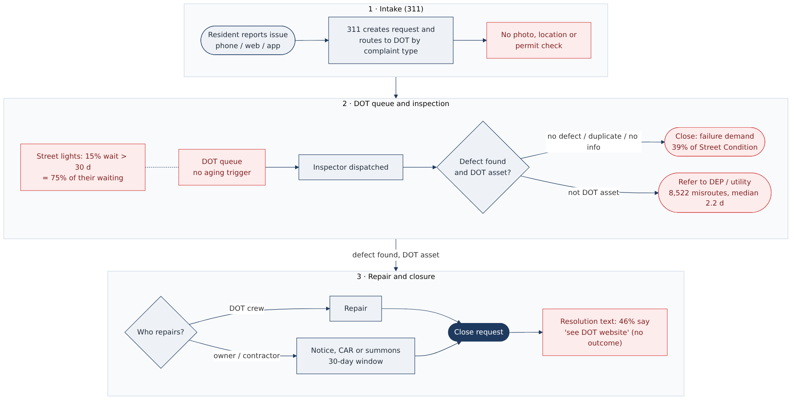 | 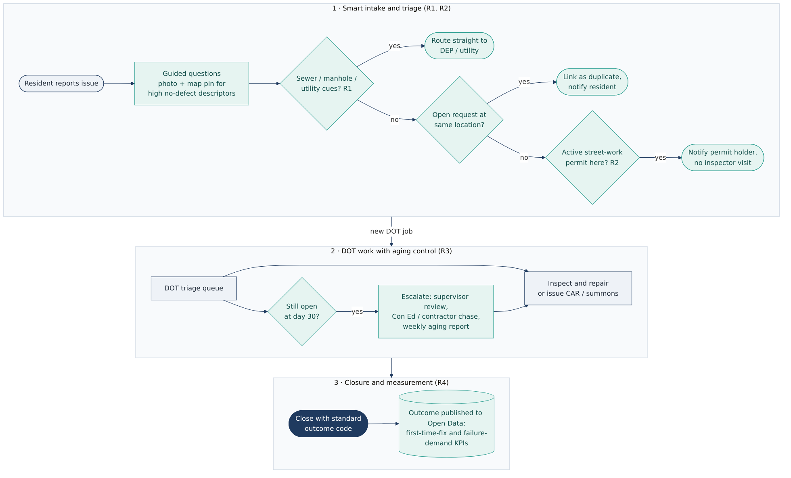 |

The Mermaid sources render directly on GitHub: [as-is](process_maps/as_is.mmd) · [to-be](process_maps/to_be.mmd).

## Slides

| | | |
|---|---|---|
| 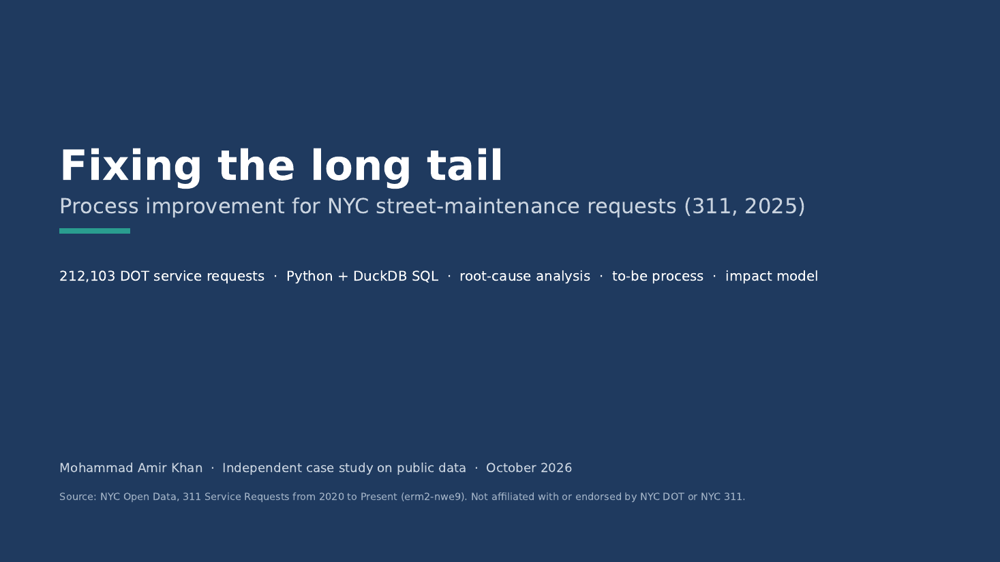 | 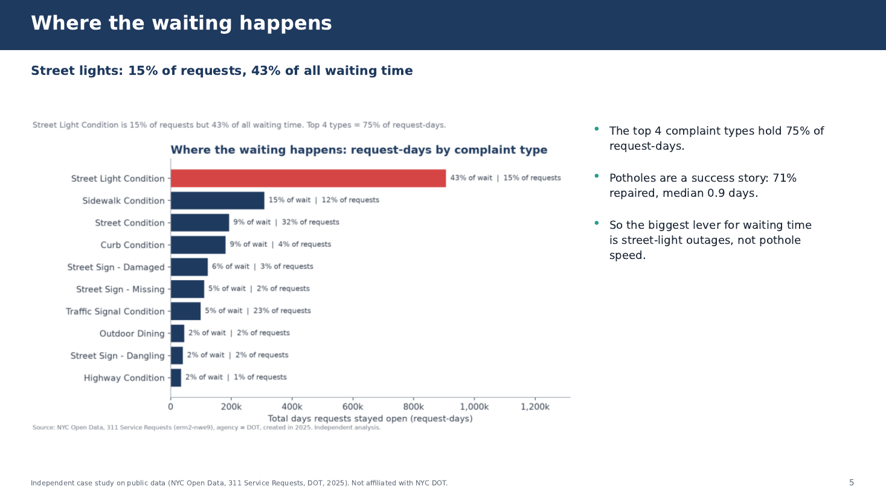 | 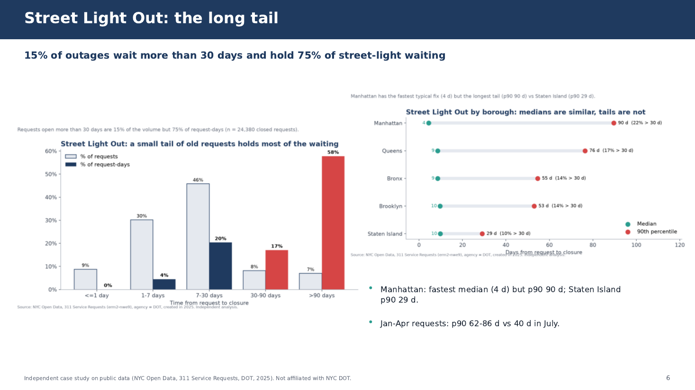 |
| 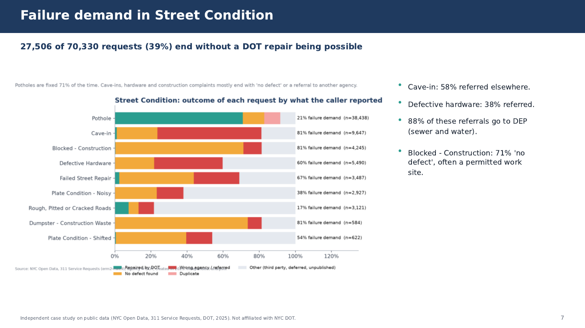 | 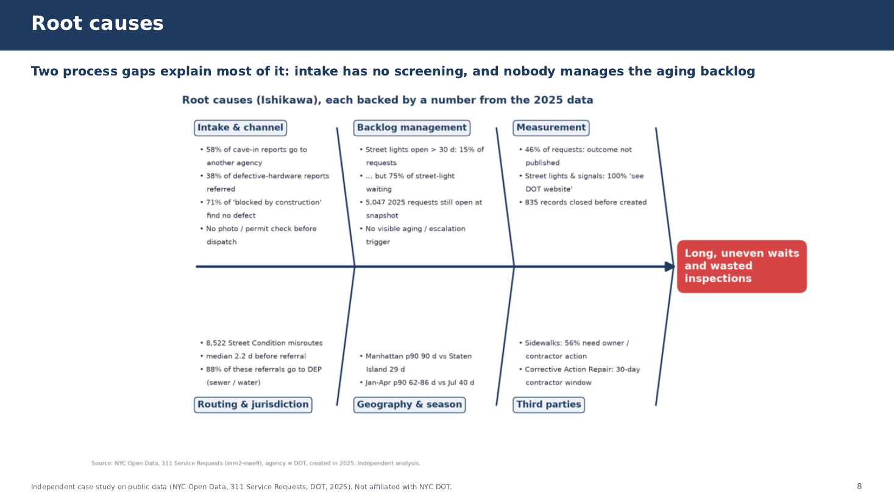 | 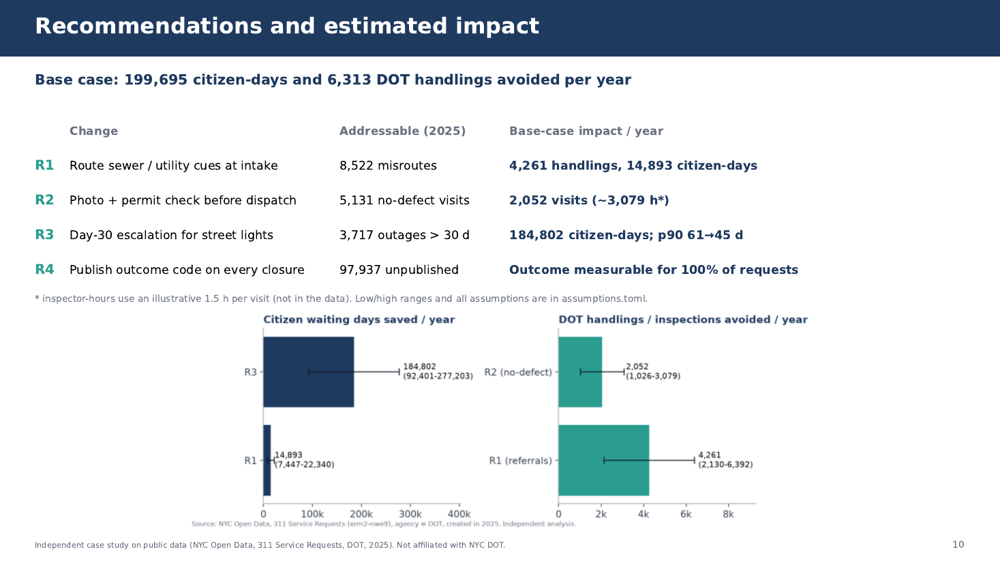 |

## How to run

```bash
git clone https://github.com/amirator/nyc311-street-maintenance-case-study.git
cd nyc311-street-maintenance-case-study
make all      # venv + pinned deps, download (~69 MB, a few minutes), SQL, validation, figures, maps, slides
make test
```

Without make:

```bash
python -m venv .venv && source .venv/bin/activate        # Windows: .venv\Scripts\activate
pip install -r requirements-dev.txt -c constraints.txt
export PYTHONPATH=src                                     # Windows: set PYTHONPATH=src
python -m case_study          # downloads the data if missing, then runs every step
python -m pytest -q
```

Process maps re-render only if mermaid-cli is installed (`make maps`, which needs Node 18+ and a
Chrome/Chromium). Otherwise the committed PNGs are kept. A re-download gives a newer snapshot, so
numbers can shift slightly. Use the committed `data/raw/manifest.json` to compare.

## Validation and tests
Every build runs `src/case_study/validate.py`, and the run fails if any check fails. The checks cover
unique request ids, row count and SHA-256 against the manifest, agency = DOT, all dates in 2025, the
set of outcome classes, a cap on the "Other" outcome share (< 5%, actual 1.3%), no negative durations
reaching the analysis, Pareto and age-band shares summing to 100%, and sort order.

`pytest` (28 tests) covers the outcome classifier on real DOT texts, the pipeline on a real 1% fixture,
the impact maths, scenario ordering, the data hash, and a check that **every headline number in this
README matches the generated `findings.json`**.

## Project layout
```text
scripts/download_data.py   dated snapshot from NYC Open Data + manifest
sql/                       01 staging, 02 outcome classifier, 03 named analysis queries
src/case_study/            pipeline, validate, impact, findings, charts, process_maps, slides, CLI
assumptions.toml           every assumption behind the impact estimates
process_maps/              Mermaid sources (as-is, to-be)
reports/                   slides PDF, findings.json, tables/*.csv (all generated)
docs/img/                  charts, rendered maps, slide previews (all generated)
tests/                     pytest + real 1% fixture
```

## Limitations
- Public 311 data only. There is no crew capacity, cost or asset data, so impact is shown in days and
  visits, not dollars. Inspector-hours use an illustrative 1.5 h per visit.
- Closure time can reflect paperwork as well as repair, and the outcome classes are the author's
  interpretation of DOT's free text, using rules documented in SQL.
- Channel is "UNKNOWN" for 58% of requests, so channel effects are not used as evidence.
- The estimates assume 2025 volumes repeat. A pilot (one borough as test, others as control) should
  replace the assumed adoption rates.

## Author
Mohammad Amir Khan · [github.com/amirator](https://github.com/amirator) ·
[linkedin.com/in/amirator](https://linkedin.com/in/amirator). Code and docs MIT. Data: see [DATA.md](DATA.md).
